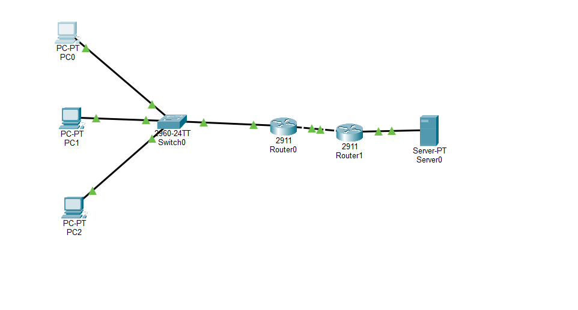

# Lab 7 — Enterprise Network Troubleshooting & Integration

## Objective

Design, configure, integrate, and troubleshoot a simulated enterprise network using Cisco Packet Tracer. Demonstrate practical networking skills across VLAN segmentation, inter-VLAN routing, DHCP, extended ACLs, static routing, and NAT/PAT.

## Network Topology

The network consists of:

- Three PCs representing Operations, Engineering, and Support
- One Cisco 2960 switch
- Two Cisco routers
- One external server

**Topology:** PCs → Switch0 → Router0 → Router1 → Server0

## IP Addressing

| Device / VLAN | IP Address | Purpose |
|---|---|---|
| VLAN 10 — Operations | 192.168.10.0/24 | Internal network |
| VLAN 20 — Engineering | 192.168.20.0/24 | Internal network |
| VLAN 30 — Support | 192.168.30.0/24 | Internal network |
| Router0 G0/0.10 | 192.168.10.1 | Operations gateway |
| Router0 G0/0.20 | 192.168.20.1 | Engineering gateway |
| Router0 G0/0.30 | 192.168.30.1 | Support gateway |
| Router0 G0/1 | 203.0.113.1/30 | NAT outside interface |
| Router1 G0/1 | 203.0.113.2/30 | WAN connection |
| Router1 G0/0 | 198.51.100.1/24 | External server gateway |
| Server0 | 198.51.100.10/24 | External test server |

## Technologies Implemented

### 1. VLAN Segmentation and Inter-VLAN Routing

Configured VLANs 10, 20, and 30 with dedicated switch access ports. Established an 802.1Q trunk between Switch0 and Router0 and configured router-on-a-stick subinterfaces to enable inter-VLAN communication.

### 2. DHCP

Configured DHCP pools on Router0 for all three VLANs, including excluded addresses, default gateways, and DNS settings. Verified successful address assignment using `show ip dhcp binding`.

### 3. Extended Access Control Lists

Configured an extended ACL to block Operations traffic destined for Engineering while permitting other IP traffic.

Validated ACL behavior through connectivity tests and match counters.

### 4. Static Routing

Configured a default route on Router0 pointing toward the ISP router at `203.0.113.2`.

Verified the gateway of last resort using `show ip route`.

### 5. NAT/PAT

Configured all three VLAN subinterfaces as NAT inside interfaces and G0/1 as the NAT outside interface.

Implemented PAT overload to allow devices across all three internal VLANs to share external IP address `203.0.113.1`.

Verified successful translations using `show ip nat translations` and `show ip nat statistics`.

## Troubleshooting Scenarios

| Issue | Root Cause | Resolution |
|---|---|---|
| VLAN trunk not operational | Router0 physical interface was administratively down | Enabled interface with `no shutdown` |
| Engineering DHCP failure | Switch port assigned to incorrect VLAN | Restored Fa0/2 to VLAN 20 |
| ACL permitted unexpected traffic | Configuration command referenced a different ACL name | Corrected ACL name and modified the intended rule |
| Operations could not access Support during ACL testing | Permit rule removed, triggering implicit deny | Restored `permit ip any any` |
| NAT translation table appeared empty | Temporary translations had expired | Generated new traffic and verified active translations |

## Verification Results

- Successfully obtained DHCP addresses on all three VLANs.
- Verified inter-VLAN routing.
- Confirmed Operations could not access Engineering.
- Confirmed Operations could access Support.
- Verified connectivity between Router0 and Router1.
- Successfully pinged the external server from all three PCs.
- Confirmed NAT/PAT translations and statistics.

## Key Cisco IOS Commands

```text
show vlan brief
show interfaces trunk
show ip interface brief
show ip dhcp binding
show access-lists
show ip route
show ip nat translations
show ip nat statistics
show running-config
```

## Key Lessons Learned

1. VLAN assignments and trunk configurations directly affect connectivity and DHCP functionality.
2. Extended ACLs process rules from top to bottom, and the first matching rule determines the action.
3. ACLs contain an implicit deny that blocks unmatched traffic.
4. Default routes provide a forwarding path to destinations outside known networks.
5. PAT enables multiple private networks to share a single external IP address.
6. NAT translations are temporary and may expire when traffic stops.
7. Systematic troubleshooting requires checking interface status, VLAN membership, routing, and security policies.

## Tools

- Cisco Packet Tracer
- Cisco IOS CLI
- GitHub

## Outcome

Successfully integrated multiple enterprise networking technologies into a functional simulated environment and resolved configuration faults using Cisco IOS diagnostic commands.

This lab demonstrates foundational skills applicable to Network Operations Center (NOC), network support, and infrastructure troubleshooting roles.
